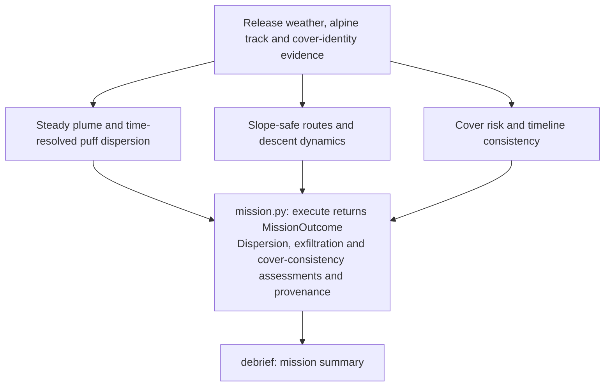

# on_her_majestys_secret_service — PIZ GLORIA

A PROJECT BOND film package drawn from **On Her Majesty's Secret Service**
(1969), mission codename **PIZ GLORIA**. It implements special-agent mission
software for an alpine operation: modeling the aerosol bioweapon (allergen)
dispersion threat (steady plume *and* time-resolved puff arrival), planning and
riding a bobsleigh-grade safe exfiltration line (slope safety, descent
kinetics, banked-curve clearance), and holding the *Bray* cover identity
(weighted risk scoring *and* timeline verification).

See [package maintenance](docs/package-maintenance.md) for dependency and metadata checks.

## Mission model



The branches group implemented capabilities; they do not imply a runtime order.

**Source map:** [`dispersion_model.py`](src/on_her_majestys_secret_service/dispersion_model.py), [`puff_dispersion.py`](src/on_her_majestys_secret_service/puff_dispersion.py); [`alpine_routes.py`](src/on_her_majestys_secret_service/alpine_routes.py), [`descent_dynamics.py`](src/on_her_majestys_secret_service/descent_dynamics.py); [`cover_identity.py`](src/on_her_majestys_secret_service/cover_identity.py), [`identity_timeline.py`](src/on_her_majestys_secret_service/identity_timeline.py); [`mission.py`](src/on_her_majestys_secret_service/mission.py).

The package implements the frozen `bond_api` `MissionProvider` protocol and is
discoverable by any BOND coordinator by its slug
`on_her_majestys_secret_service`.

## What it does

Six pure, deterministic, infrastructure-free domain modules:

| Module | Concept | Method |
| --- | --- | --- |
| `dispersion_model.py` | Aerosol bioweapon (allergen) dispersion | Gaussian plume, Pasquill-Gifford stability, valley-channeled transport |
| `puff_dispersion.py` | Time-resolved dispersion / early warning | Lagrangian Gaussian puff train superposition |
| `alpine_routes.py` | Alpine route planning (bobsleigh grade) | Track geometry + slope-safety-gated Dijkstra |
| `descent_dynamics.py` | Bobsleigh descent + banked-curve physics | Point-mass kinematics, lateral g, banked-curve speed limit |
| `cover_identity.py` | Cover-identity risk (Bray persona) | Weighted additive risk scoring |
| `identity_timeline.py` | Cover-timeline verification | Interval coverage / consistency analysis |

Plus the thin protocol adapter:

* `mission.py` — `MissionProvider` (brief / recon / plan / execute / debrief)
  with deterministic provenance and gadget registration. Public protocol shape
  is stable: `film`, the five methods, and the `register_gadgets` hook
  (module-level `REGISTRY`).
* `manuscript_variables.py` — `{{TOKEN}}` hydration from config + live results.
* `figures/` — matplotlib rendering of the plume footprint, puff time series,
  and descent speed profile.

## Layout

```
src/on_her_majestys_secret_service/   importable package (domain + mission)
scripts/                               thin mission-phase CLIs
tests/                                 real-data, mock-free test suite
manuscript/                            config + sections + layer contract
docs/                                  agent instructions, architecture, testing
```

## Install & verify

From this directory:

```bash
uv sync --extra dev
uv run python -m pytest tests/ --cov=src --cov-fail-under=90
uv run ruff check src/ scripts/ tests/ && uv run ruff format --check src/ scripts/ tests/
uv run mypy src/ scripts/
```

Run the mission phases:

```bash
uv run python scripts/00_preflight.py  # environment check
uv run python scripts/01_brief.py      # mission definition
uv run python scripts/02_recon.py      # recon findings
uv run python scripts/03_plan.py       # execution plan
uv run python scripts/04_execute.py    # run + write outcome/figures
uv run python scripts/05_debrief.py    # lessons
uv run python scripts/z_generate_manuscript_variables.py   # hydrate tokens
```

Published at `github.com/docxology/bond-on_her_majestys_secret_service` (the
`origin` remote). The `bond-api` protocol it consumes is recorded inside this
repository at `vendor/bond-api`, so `uv sync --extra dev` resolves the
dependency from the clone itself, with no sibling checkout and no separate
install step.

## Integration

The `MissionProvider` in `mission.py` satisfies the frozen `bond_api`
protocol; `bond_api.discovery.load_provider("on_her_majestys_secret_service")`
resolves it for coordinators. Gadgets (dispersion and puff models, the plume
isopleth, the alpine planner, the descent simulator and bobsleigh audit, the
cover risk scorer, and the timeline verifier) register into a `GadgetRegistry`
on import.
